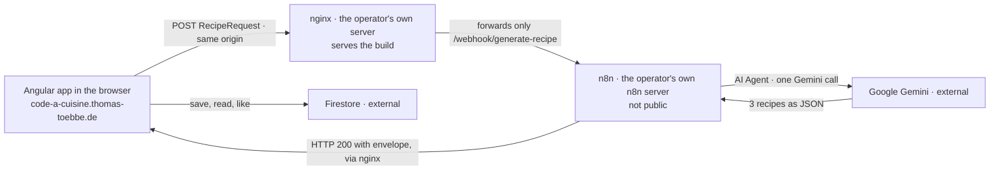

# Code à Cuisine

**Live: [code-a-cuisine.thomas-toebbe.de](https://code-a-cuisine.thomas-toebbe.de)**

A recipe generator built as a Developer Akademie project. You say what is still in the fridge and how
you want to cook — an n8n workflow has an LLM turn that into three recipes and hands them back to the
Angular frontend as JSON. All three suggestions land in a shared Firestore library (the "Cookbook")
automatically, where they can be found again and liked.

No sign-in, by design: the cookbook is public, everyone sees the same library, and there is no
account to create before cooking. That decision moves the entire protection into the
[Firestore security rules](firestore.rules) — see [docs/firebase.md](docs/firebase.md).

## How it runs in production



| Part           | Where it runs                                    | Gets there via                        |
| -------------- | ------------------------------------------------ | ------------------------------------- |
| Frontend       | the operator's own server, nginx, static build   | the operator's deploy script, by hand |
| Generation     | the operator's own n8n server, behind that nginx | manual import in the n8n editor       |
| Recipe library | Firebase Firestore, collection `recipes`         | nothing to deploy, console only       |

The frontend is a plain static bundle — the Angular CLI build (esbuild/Vite under the hood) produces
HTML, JS and CSS. The web server that serves it also forwards the one webhook path to n8n, so the
browser only ever calls its own origin and the production build carries no n8n host at all.

The two paths never meet in the backend: n8n does **not** write to Firestore. The frontend talks to
Firestore directly and creates the three suggestions itself as soon as the response arrives.

What the server has to provide, how a deployment runs and what to check afterwards:
**[docs/deployment.md](docs/deployment.md)**.

## Tech stack

- **Frontend:** Angular 21 (standalone components, signals), SCSS
- **Generation:** n8n workflow in Docker → Google Gemini (`gemini-3.5-flash`)
- **Library:** Firebase Firestore, collection `recipes` — external, same project in dev and prod

## Local development

Development runs entirely on your machine — including n8n, which the dev build calls on
`http://localhost:5678` instead of the production webhook. Nothing here touches the live site; that
only moves when the operator deploys a commit.

```bash
npm install
cp src/environments/firebase.config.example.ts src/environments/firebase.config.ts
npm start           # http://localhost:4200
```

`firebase.config.ts` is gitignored and has to be copied and filled in by hand once per machine — no
npm hook does it for you. Until the `TODO-…` placeholders are replaced the app still runs, only the
Cookbook shows its error state.

| Concern          | Development                              | Production                                          |
| ---------------- | ---------------------------------------- | --------------------------------------------------- |
| App              | `ng serve` on `localhost:4200`           | static build on the operator's own server           |
| Environment file | `environment.ts`                         | `environment.prod.ts` (swapped at build)            |
| Webhook          | `http://localhost:5678/webhook/…`        | `/webhook/…`, same origin, forwarded to n8n         |
| Firebase config  | copied by hand from the example          | the operator's filled-in copy, used by the build    |
| Quota per IP     | everything lands in the bucket `unknown` | real client IP via `x-forwarded-for` from the proxy |

The full walkthrough — Firebase values, rules, index and the local n8n setup — is in
**[docs/installation.md](docs/installation.md)**.

## npm scripts

| Command                    | Purpose                                                   |
| -------------------------- | --------------------------------------------------------- |
| `npm start`                | Dev server on port 4200                                   |
| `npm run build`            | Production build into `dist/`                             |
| `npm run watch`            | Build in watch mode                                       |
| `npm run lint`             | ESLint including Angular template rules                   |
| `npm run sync:ingredients` | Refreshes the ingredient autocomplete list from TheMealDB |

`sync:ingredients` merges TheMealDB's list with a hand-picked set kept in the script itself, so the
everyday names the API lacks never drop out. It is a build-time step, not something the app does at
runtime: it writes
`src/app/generator/ingredient-step/ingredient-names.ts`, which is committed and shipped in the
bundle. The generator therefore needs no network call for its autocomplete. Run it only when the
list should be refreshed, then commit the diff.

## CI and deployment

GitHub Actions only checks; it deploys nothing and needs no secrets:

| Workflow | Runs on                           | Does                                        |
| -------- | --------------------------------- | ------------------------------------------- |
| `ci.yml` | push and pull request, any branch | `npm ci` → `npm run lint` → `npm run build` |

The deployment is started by hand by the operator: a script in the operator's private infrastructure
repository builds a given commit locally and ships the build output to the server. Merging into
`main` therefore verifies the code without publishing it.

The n8n side has no workflow of its own either: the JSONs in [n8n/](n8n/) are imported in the n8n
editor via **Import from File**, which keeps the live workflow active and its webhook registered —
the CLI import does not.

Details, the GitHub secrets left over from the old setup and what the server has to provide are in
**[docs/deployment.md](docs/deployment.md)**.

## Project structure

```
src/app/
  home/          Landing page, entry point into the wizard
  generator/     Wizard: ingredients, preferences, loading state, error dialog
  results/       List of the three suggestions
  recipe-view/   Recipe view — for suggestions and saved recipes alike
  library/       Cookbook: category tiles, card list, "Most liked" row
  header/        Header with the logo link back to the landing page
  footer/        Footer with the imprint and privacy links
  imprint/       Imprint
  privacy/       Privacy policy
  models/        Interface and union types (request, response, recipe, filters)
  services/      n8n webhook, generation state, Firestore access
  firebase/      Firestore provider for the app config
  guards/        Route guards for the results page and the cuisine routes
  shared/        Pagination component and formatting helpers for recipe data
scripts/         Build-time helpers, e.g. the ingredient list sync
public/          Static assets copied into the build
n8n/             Both workflows as exported JSON
  deploy/        Compose file and Caddy config of the former VPS, no longer used
docs/            Installation, architecture, webhook interface, Firebase, deployment
.github/
  workflows/     CI: lint and build
```

## Documentation

- [docs/installation.md](docs/installation.md) — from `git clone` to a running app locally
- [docs/architecture.md](docs/architecture.md) — the big picture and the decisions behind it
- [docs/n8n-webhook.md](docs/n8n-webhook.md) — webhook interface, error codes, quota
- [docs/firebase.md](docs/firebase.md) — config, schema, rules, index, test data
- [docs/deployment.md](docs/deployment.md) — the live setup, secrets, and how a deployment runs
- [n8n/README.md](n8n/README.md) — importing the workflows, creating the credentials
